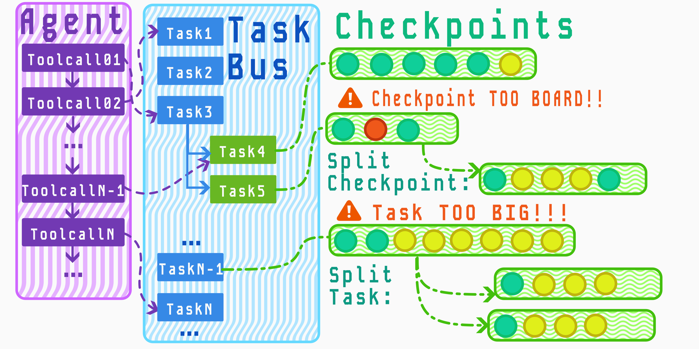

# pi-taskbus

pi-taskbus gives Pi a task tree that stays connected to actual tool use. Every work call belongs to a checkpoint, progress follows completed or explicitly ignored checkpoints, and confidence decay helps the agent notice when a checkpoint hides more work than its plan describes.



## Install

Requires Node.js 22.19.0 or later; tested with Pi 1.5.2.

```sh
pi install npm:pi-taskbus
```

Start a new Pi session or run `/reload` after installation. To pin a release, use `pi install npm:pi-taskbus@0.1.0`; to try it for one invocation, use `pi -e npm:pi-taskbus`.

## How it works

The agent creates leaf tasks with explicit checkpoints through `task_manage`, then runs work through `task_run` with a task ID and pending checkpoint ID. The gateway enforces that attribution and preserves the original tool's validation, permission checks, streaming output, and cancellation. Nested in-process tools inherit the same attribution.

Progress is `(done + ignored) / total` across a task's subtree, with separate completed and ignored counts. Ignore is reversible and preserves every node, original completion result, and audit event. Confidence tracks planning granularity: `confidence = decay ^ effort`, with a default decay of `0.95` per executed leaf work call. Low confidence suggests hidden work worth making explicit; correctness is established through the work's own verification. Executed calls that return errors count as effort, while validation failures, permission blocks, and pre-execution cancellations count zero. Orchestration calls with executed children retain an audit entry, and their leaf calls supply the effort.

Default reminders appear below 60% and 30% confidence, reached on the tenth and twenty-fourth counted calls, and repeat after five more effort units. The agent can split a broad checkpoint into smaller checkpoints or group a large task into child tasks. Checkpoint splitting archives the original and distributes its historical effort; task splitting preserves checkpoint IDs and assigns each active checkpoint exactly once. Splitting changes the progress denominator to reflect the refined scope.

Completing a checkpoint records a summary and freezes its confidence; reopening requires a reason and retains previous effort. Task confidence is the effort-weighted average of active descendant checkpoints, including completed ones, with weight `max(1, effort)`. A separate reminder suggests splitting tasks with more than eight checkpoints.

## Dependencies and review

The harness derives `certain`, `uncertain`, and `ignored` independently of completion. A checkpoint is certain unless effectively ignored. Tasks are certain when all children are certain, uncertain when some children are uncertain or ignored, and ignored when all children are ignored or the task or an ancestor is explicitly ignored. A nonignored task becomes `certainly done` or `uncertainly done` once its descendant checkpoints are done or ignored; empty, unplanned leaves keep ancestors pending. Ignored tasks never become done, even at 100% disposition progress.

Each node can declare prerequisites such as `[{"id":"T-1","kind":"strict"}]`. Strict prerequisites must stay certain and be clean, certainly done before work can run; soft prerequisites must stay nonignored and can be clean, certainly or uncertainly done. Dependencies on ancestor tasks also gate descendant work, and cross-page dependencies use globally unique IDs. Operations that would violate an existing prerequisite's certainty are rejected atomically.

Changes to prerequisite evidence—ignore, restore, split, reopen, dependency edits, or added work—mark downstream nodes `dirty`. Dirty propagates through dependency chains and task aggregation. Dirty prerequisites block their consumers; direct dirty on a task blocks its descendants, while aggregate dirty from a child leaves healthy sibling work available. Use `available` with `includeBlocked:true` to inspect the blockers.

The agent must review a dirty node with `refresh`, supplying a summary and optionally replacing its full prerequisite list atomically. Refreshing a done checkpoint explicitly chooses `outcome:"keep"` or `outcome:"reopen"`; pending, clean prerequisites permit review but still block execution until done. Dirty prerequisites need review first or must be replaced. Split checkpoints remain archived with original dependency edges visible until their consumers explicitly rebuild those edges. Each node's ignore switch is retained independently, so restoring a parent preserves its children's choices and marks restored work dirty for review.

## Everyday use

The agent manages the plan as it works, and you can inspect it at any time:

- The resident tree above the editor shows progress, confidence, and active work. Use `Alt+j/k` to move and `Alt+h/l` to fold, unfold, or move between parents and children. Switch pages with `Alt+Shift+h/l`.
- Open `/taskbus` for the full tree. Use `j/k` or arrows to move, `h/l` to fold or unfold, `/` to search, `Enter` for details, and `Esc` to close. `o/z` expands or folds all nodes; `g/G` selects the first or last row; `c` clears search. `Shift+h/l` cycles pages, preserving each page's selection, folding, and search. Dependency details wrap to the available width; use `PgUp/PgDn` to scroll long details.
- Use `/taskbus json` for the current state and `/taskbus history` for recent events. After fixing a persistence error, use `/taskbus recover` to replay pending accounting on its original session branch.

Both trees show prerequisite markers (`←S:CP-1` for strict, `←s:T-1` for soft, and `^` for inherited constraints) and `blocked` when pending work cannot run. Narrow rows show a prerequisite count instead. Node details list own and inherited prerequisites separately, with target page IDs, states, and concrete blocker reasons.

The resident panel is bounded to leave space for recent tool output. Pending/done, ignored (`⊘`), dirty (`!dirty`), selection, and confidence have separate visual cues, with cyan summaries and theme-aware focus colors. Built-in `edit`, `write`, and `bash` tools keep native diffs, previews, and streaming renderers; other extension tools use collapsible text output. Interface labels are English, and user-authored task content keeps its original language.

## Agent tools

Call `task_manage` directly to inspect `pages`, create a new page with `page_create(title)` when needed, and create the plan. Each page is a virtual root containing top-level tasks; browsing does not change where the agent creates or executes work. Top-level tasks require `pageId`, while child tasks inherit their parent's page. Wait for the returned IDs before submitting `task_run`. For example, create a task with `{"action":"task_create","pageId":"P-1","title":"Update authentication","checkpoints":["Inspect the request contract","Implement and test the change"]}`, then execute work using the actual returned IDs:

```json
{
  "taskId": "T-1",
  "checkpointId": "CP-1",
  "tool": "read",
  "args": { "path": "src/auth.ts" }
}
```

The main `task_manage` actions are:

- Inspect with `pages`, `available(pageId?, taskId?, includeBlocked?)`, `list(taskId?, pageId?)`, `history(id?, limit?)`, or `tools(query?)`; `tools` returns original tool schemas and usage guidance.
- Plan with `page_create(title)`, `task_create(title, checkpoints, pageId?, parentId?, dependencies?)`, `checkpoint_add(taskId, title, dependencies?)`, and `rename(id, title)`.
- Set or restore ignore with `ignore(id, ignored, reason)`; edit prerequisites with `dependencies(id, dependencies, reason)`; review with `refresh(id, summary, dependencies?, outcome?)`. All these actions preserve history.
- Record outcomes with `complete(checkpointId, summary)` and `reopen(checkpointId, reason)`.
- Refine with `checkpoint_split(checkpointId, parts)` or `task_split(taskId, groups)`. Checkpoint parts contain `title` and optional positive `share` values, supplied for all parts or none; task groups contain `title`, `checkpointIds`, and optional `dependencies`. New split checkpoints inherit original prerequisites, ignore choices, and outstanding dirty reasons by default; `parts[].dependencies` can explicitly refine their prerequisites. Both splits require at least two parts or groups.

## Configuration and recovery

Configuration merges built-in defaults, global `<Pi agent dir>/taskbus.json` (usually `~/.pi/agent/taskbus.json`), and trusted-project `.pi/taskbus.json`. See [`taskbus.example.json`](./taskbus.example.json) for settings and reminder templates. Scalar overrides merge individually, while `thresholds` replaces the inherited array. Each session saves its effective configuration, so edits apply to new sessions.

Historical sessions migrate into the default page (`P-1`) with IDs and task structure preserved. New event records carry a semantic revision so branch replay reproduces dependency and dirty transitions. Task events replay from the current Pi session branch, with archived checkpoints and execution history retained. Completed work is journaled under `<Pi agent dir>/taskbus-recovery/` before session persistence; a failed write pauses later work until recovery. The journal preserves accounting, while tool arguments and results remain in Pi's session records. If the process exits during a tool call, inspect external effects before deciding how to continue.

Attribution covers nestable tools in the current host process, including registered MCP tools. Model-only tools need dedicated adapters, independent subagents count the delegation call, and manual shell commands or extensions accessing Node.js directly are outside the tool-event chain. Coordinate model instructions when running alongside another task-management extension.

## Development

```sh
git clone https://github.com/Moonhalf383/pi-taskbus.git
cd pi-taskbus
npm ci
npm run validate
npm run test:package
pi -e ./src/index.ts
```

`npm run validate` runs TypeScript checks and tests for tracking, concurrency, recovery, SDK execution, and terminal rendering. `npm run test:package` installs a generated tarball in a temporary project and loads it through Pi. CI runs both on Node.js 22.19.0 and 24; live MCP services and real terminal appearance should also be checked in the target environment.

See [`docs/verification.md`](https://github.com/Moonhalf383/pi-taskbus/blob/main/docs/verification.md) for the requirement-to-test audit and review scope. See [`docs/mechanisms.md`](https://github.com/Moonhalf383/pi-taskbus/blob/main/docs/mechanisms.md) for the detailed state and dependency contract. See [`CHANGELOG.md`](./CHANGELOG.md) for release notes and [`RELEASING.md`](https://github.com/Moonhalf383/pi-taskbus/blob/main/RELEASING.md) for the npm release procedure. Licensed under [MIT](./LICENSE).
